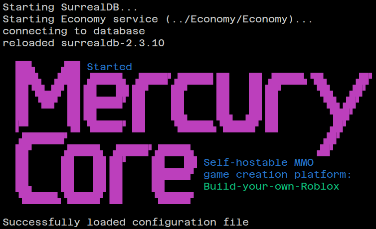

This page provides information about the Site service in Mercury Core, including its functionality, features, and how it integrates with other services.

## Startup

A development server can be started with `bun dev`. This will start the server in development mode (by default on port 5173), enabling features like hot-reloading for easier development. For a production preview, run `bun run build` followed by `bun preview` (or both at once by using `bun run buildview`). This will start a production preview server (by default on port 4173). The ports for these services will automatically increment by 1 if the default ports are already in use until a free port is found. The development server starting on an unexpected port is an indication that there is probably already a development server running, and you may wish to stop it before starting a new one.

For a full production deployment, run `bun run build` followed by `bun -b ./build`. The server will be started on the port specified in your **.env** file. We use port 4443, and if not specified the default is 3000, though this can be changed to any port you wish.

## Running behind Caddy

The Site expects to run behind a reverse proxy such as Caddy, and should not be reachable directly. Listen on loopback only (`HOST=127.0.0.1`; **ecosystem.config.js** and **compose.yml** already do this), and set `ADDRESS_HEADER=X-Forwarded-For` and `XFF_DEPTH=1` so the Site can tell clients apart. Without them every client appears to come from the proxy's address, so ratelimits apply to the whole site at once. Caddy replaces any `X-Forwarded-For` header sent by the client with the client's real address, so it can't be spoofed as long as nothing else can reach the Site. Don't set `ADDRESS_HEADER` if the Site is exposed to clients directly, as then they can choose their own address.

If you have a firewall, there's no need to open port 4443 to the outside.

On successful startup, the Site will display output similar to the following:

```
Starting SurrealDB...
Starting Economy service (../Economy/Economy)...
connecting to database
reloaded surrealdb-4.0.0

  ██▙    ▟██ Started
  ███▙  ▟███ ▟████▙ ▗████▛▗█████▌██   ██ ▟████▙▝█▙    ▗█▛
  ██▝█▙▟█▘██▐█▌  ▐█▌██▘   ██▘    ██   ██▐█▛     ▝█▙  ▗█▛
  ██ ▝██▘ ██▐█████▛ ██    ██     ██   ██▐█▌      ▝█▙▗█▛
  ██      ██▐█▌     ██    ██▖    ██▖ ▗██▐█▌       ▝██▛
  ▛▀      ▜█ ▜████▛ ██    ▝█████▙▝█████▘▐█▌       ▗█▛
  ▗██████▛                                       ▗█▛
  ██▘    ▗█████▖ ▟████▛▗█████▖                  ▗█▛
  ██     ██   ██▐█▛    ██   ██ Self-hostable MMO
  ██     ██   ██▐█▌    ██████▘ game creation platform:
  ██▖    ██   ██▐█▌    ██      Build-your-own-Roblox
  ▝█████▙▝█████▘▐█▌    ▝█████▘

Successfully loaded configuration file
```



## Economy authentication

If you run the Site and Economy service outside containers, the Site reads `ECONOMY_KEY` from **Site/.env** and passes it to the Economy service when auto-starting it. If you start the Economy service yourself, set the same `ECONOMY_KEY` in its environment. The service refuses to start without a key and rejects any request that doesn't carry it. It listens on `127.0.0.1:2009` by default; pass `-addr :2009` only when another container must reach it over a container network.

For compose deployments, set `ECONOMY_KEY` in a **.env** file next to **compose.yml** (copy **.env.example** and replace the value); compose passes it to both containers and keeps the Economy port bound to loopback.
